# iptv-app

A free IPTV player for Android phones and TVs. Live TV, sports, replays, highlights, movies, series and multiview. Bring your own M3U, Xtream or Stalker / MAC playlist. No channels or subscriptions are included.

## Download

- **TV:** Install [Downloader by AFTVnews](https://play.google.com/store/apps/details?id=com.esaba.downloader) and enter **3461840**.
- **Phone:** [Download the APK](https://github.com/akus0/iptv-app-public/releases/latest/download/iptv-app.apk) and open it to install.

One release APK includes both 32-bit and 64-bit ARM support for Android 7.0+. Android selects the appropriate version for your device. [Installation help](docs/install.md) · [Releases](https://github.com/akus0/iptv-app-public/releases)

## Get started

1. Open **Settings → Playlists & guide → Add playlist**, choose your playlist type and enter your details.
2. Choose which content to include under **Content from this playlist**, where supported.
3. Use **Organise with iptv-app** or **Keep provider categories**. Open your playlist's **Manage categories** settings to choose what appears in Live TV, Movies and Series.

## Explore the app

- **Live TV:** A programme guide, channel categories, favourites, history and a preview alongside your browsing.
- **Sports:** Events and scores, guide-based channel matching, alternative channels, favourite teams and leagues, standings, schedules, replays and highlights. Coverage depends on the available sports feeds and your guide data.
- **Movies & Series:** Browse categories, search across your library, save favourites and continue watching.
- **Settings:** Manage playlists, content visibility, guide sources, appearance and playback in compact screens designed for touch and TV remotes.

See the [changelog](CHANGELOG.md) for release details.

## Screenshots

Current-source screenshots with populated sample playlists, fictional scores and schedules, and original demo artwork. They show the interface, not content supplied with the app. Published releases may differ from the current source.

**Live TV on a television**

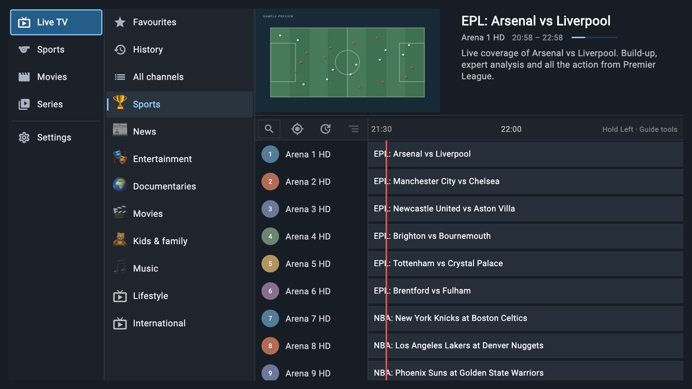

**Sports on a television**

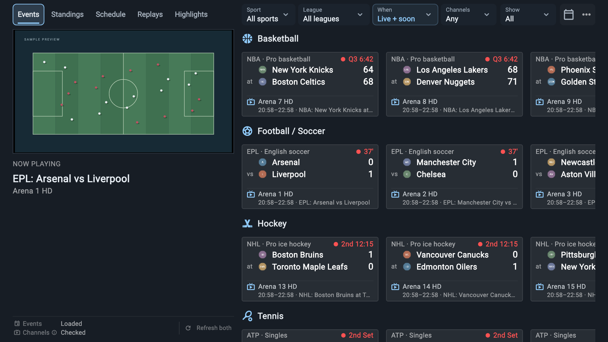

| Live TV on phone | Sports on phone |
| --- | --- |
| 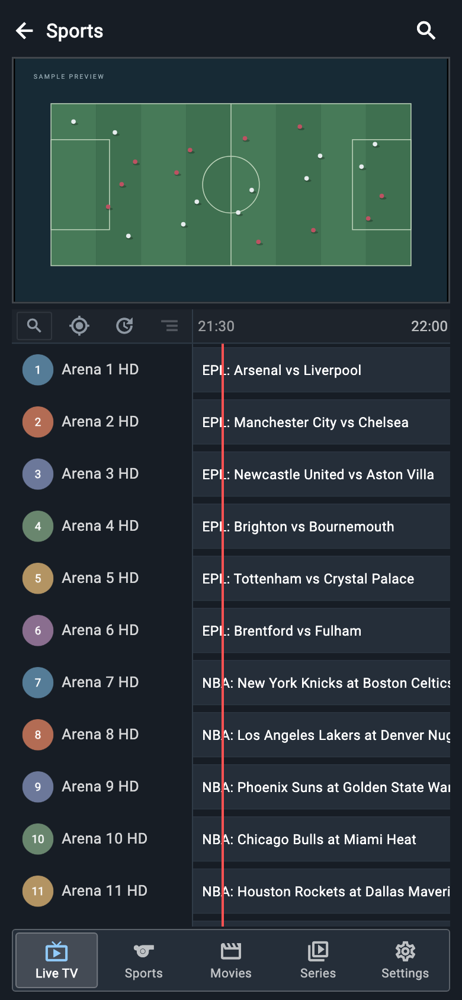 | 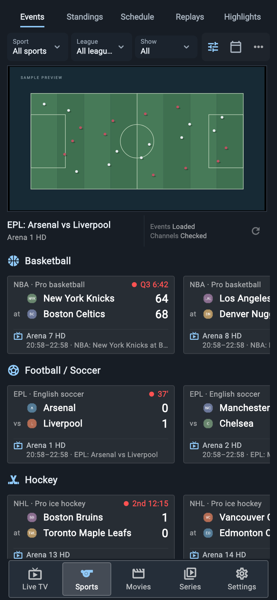 |

Schedule, standings and settings

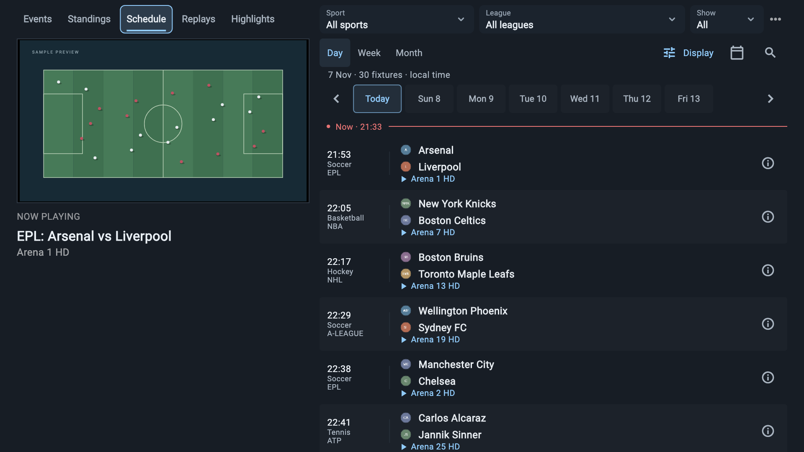

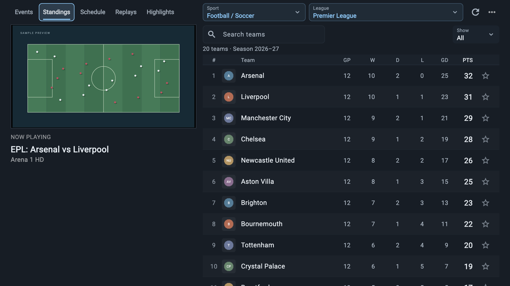

| Schedule on phone | Standings on phone |
| --- | --- |
| 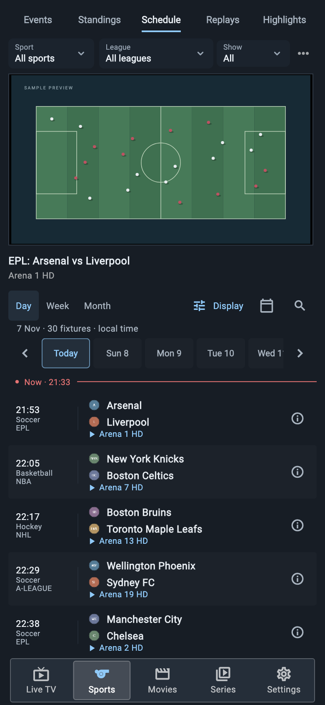 | 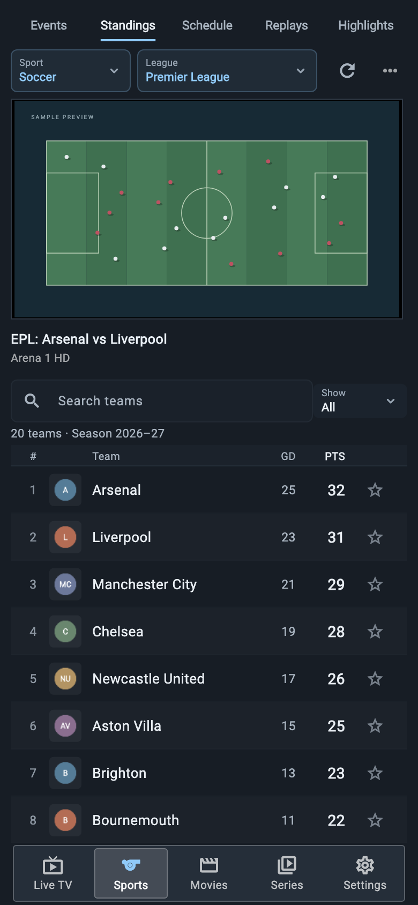 |

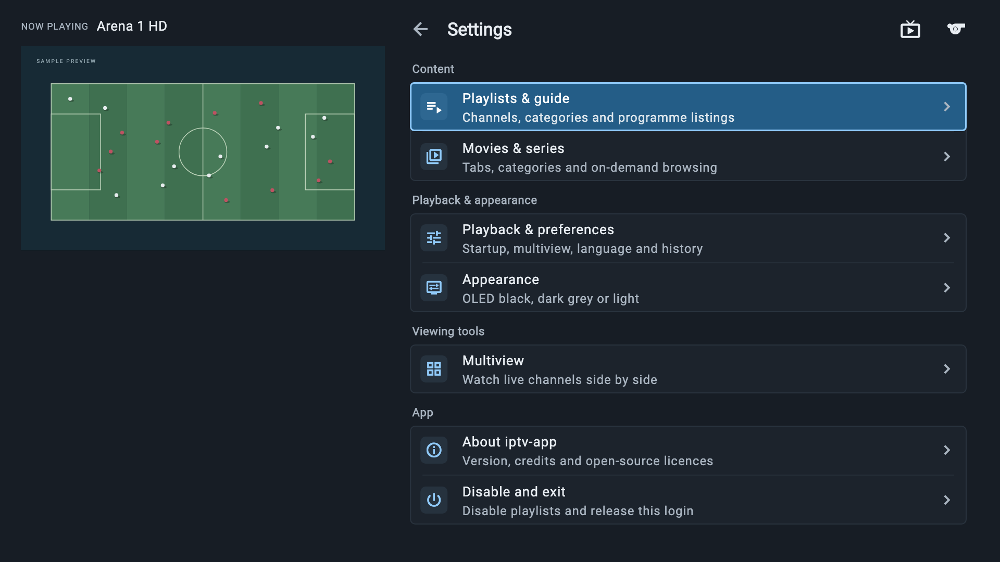

Replays, highlights, movies and series

| Replays | Highlights |
| --- | --- |
| 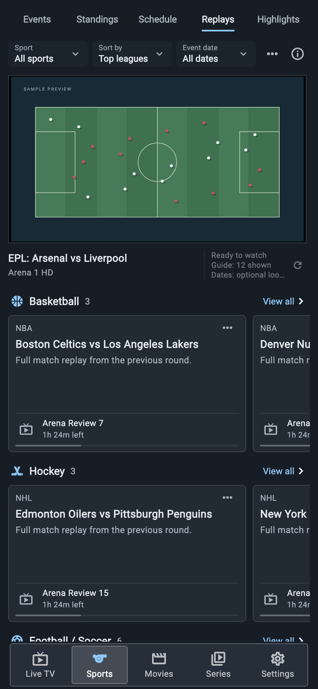 | 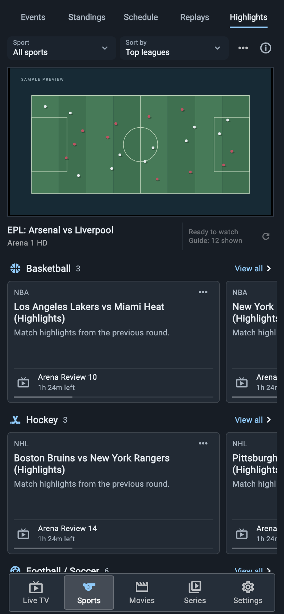 |

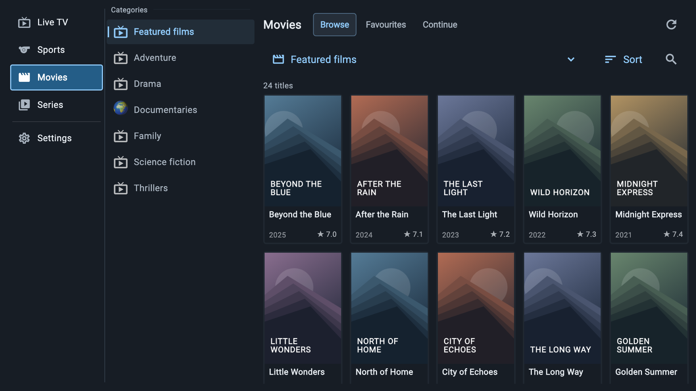

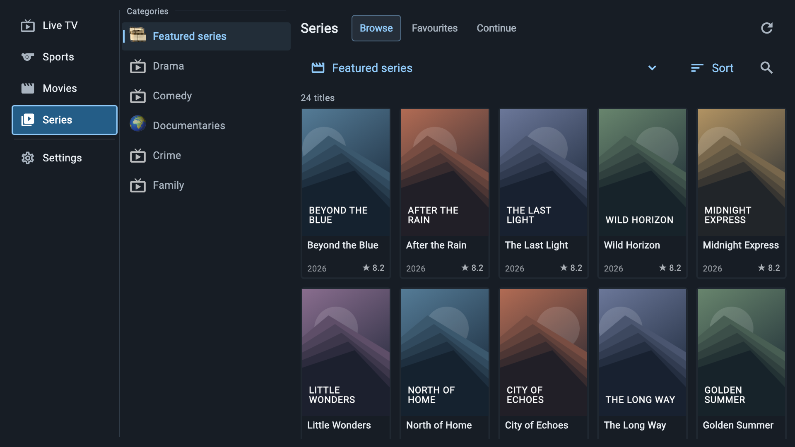

Phone landscape

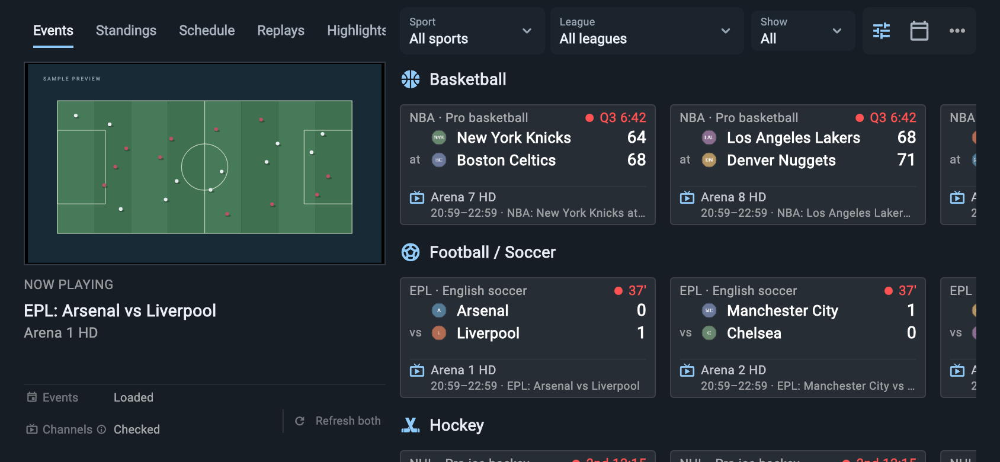

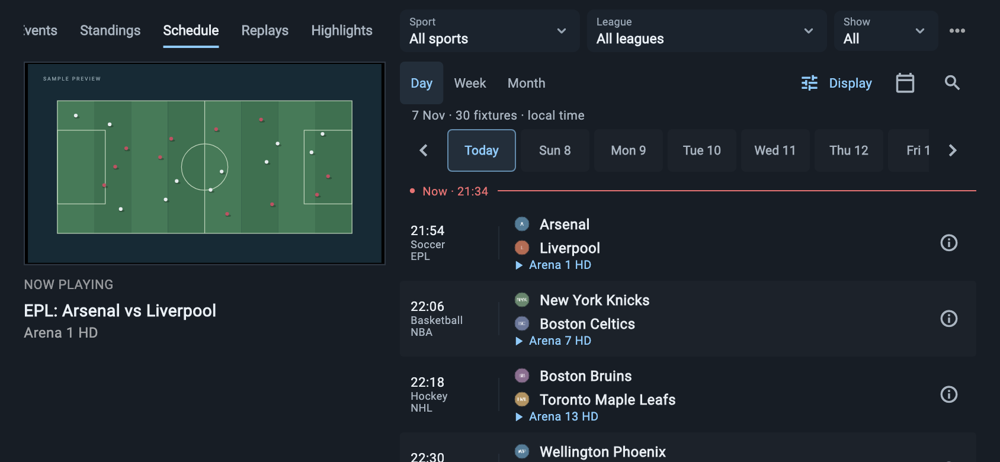

[Full screenshot gallery and sample-data details](docs/screenshots/README.md)

## Development & licence

[Build instructions](docs/development.md) · [Release preparation](docs/release.md) · [Changelog](CHANGELOG.md)

[GPL-3.0](LICENSE). Based on [VesperTV](https://github.com/NoXqc/VesperTV) by NoXqc and contributors; independently maintained. [Attribution](NOTICE.md) · [Trademark terms](TRADEMARKS.md)
