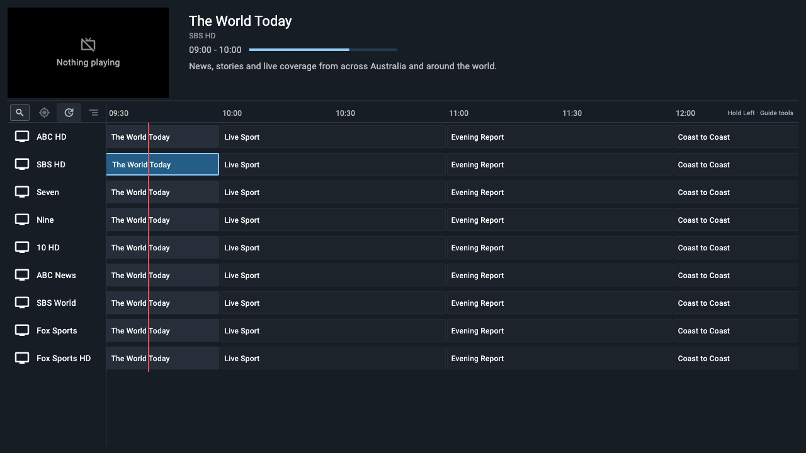
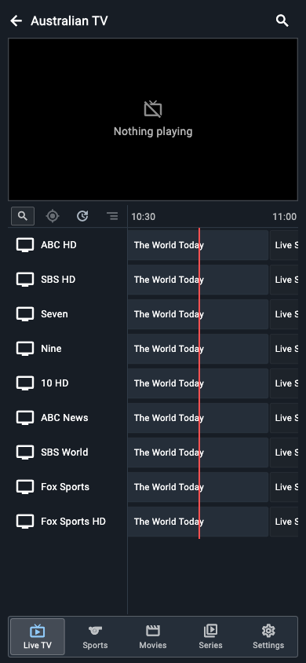
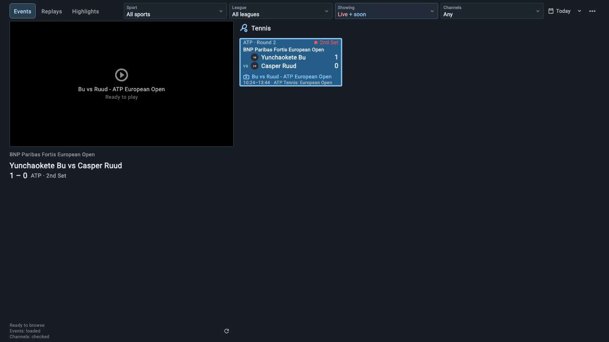
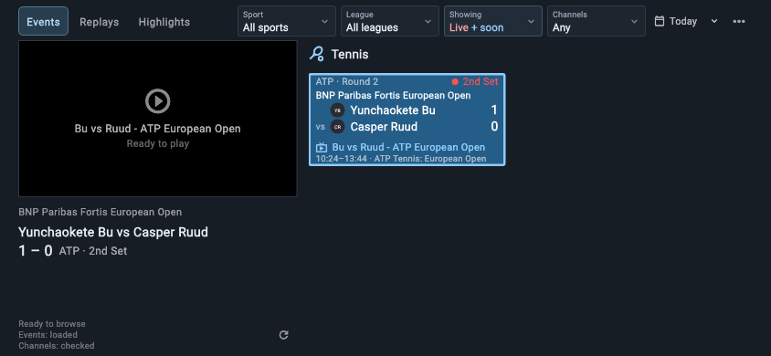
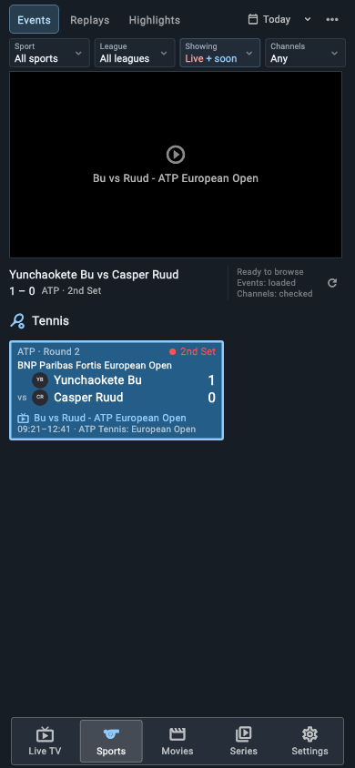
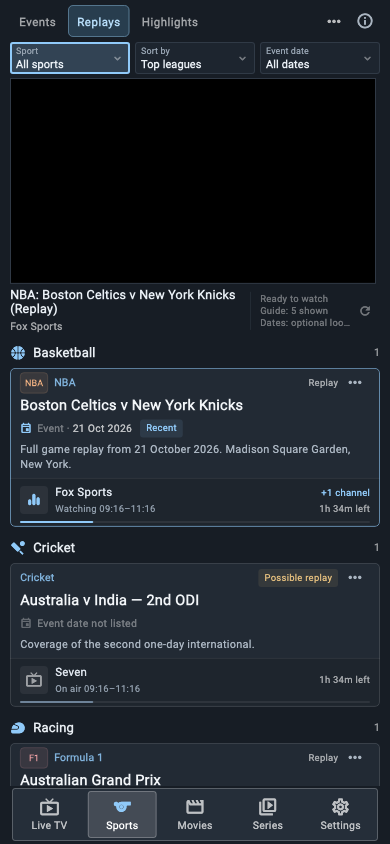
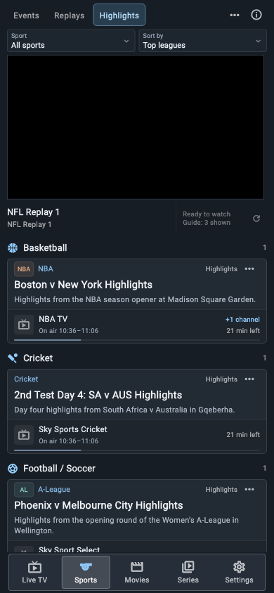
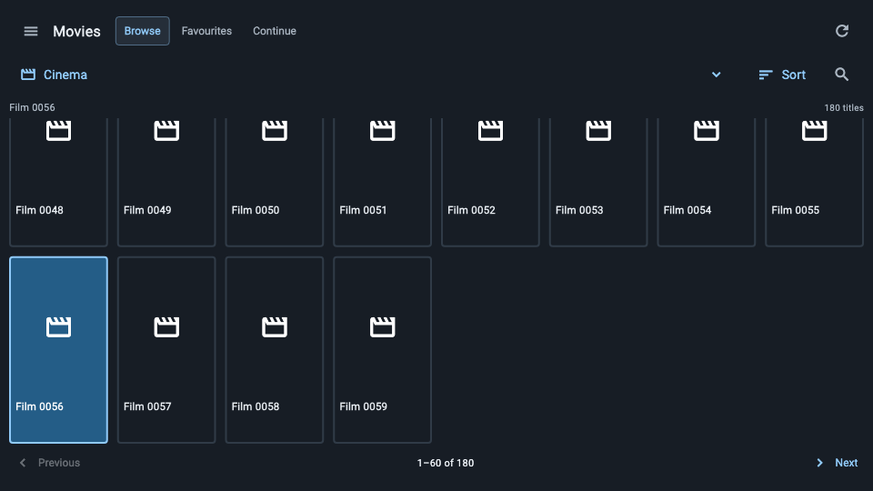

# App screenshots

Rendered from the current Flutter widgets with sample channels, events and a test catalogue. No subscription streams or account details are used; video previews and movie posters are intentionally empty.

## Live TV





## Sports





| Events on phone | Replays on phone |
| --- | --- |
|  |  |



## Movies



## Refresh these images

Use the screenshot cases in `test/live_layout_navigation_test.dart` and `test/library_test.dart`. Set `LAYOUT_FONT_DIR` to a local folder containing `Roboto-Regular.ttf` and `MaterialIcons-Regular.otf`:

```sh
flutter test --concurrency=1 --dart-define=CAPTURE_LAYOUT=true --dart-define=LAYOUT_FONT_DIR=/path/to/fonts test/live_layout_navigation_test.dart --name 'guide and navigation fit (1280|390)|tennis tournament cards fit (390|844|1280)'
flutter test --dart-define=LAYOUT_FONT_DIR=/path/to/fonts test/library_test.dart --name 'library fits Size\(960'
```

The tests write PNGs to `/tmp`. Review them before replacing the files here. Keep real-device captures and private data outside the repository.
